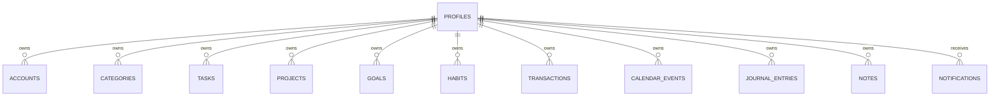
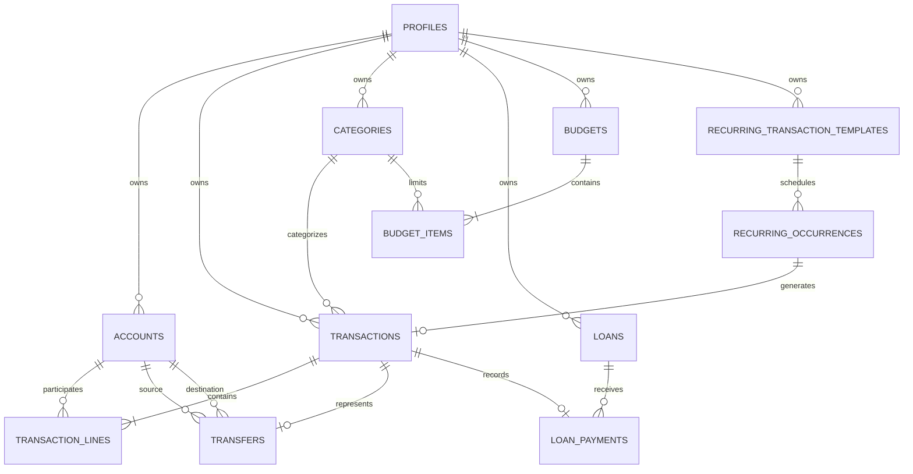
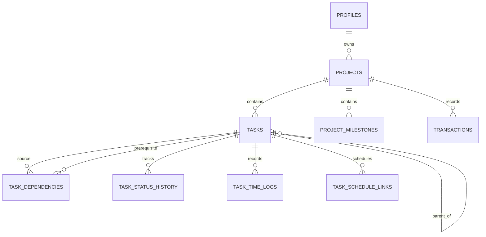
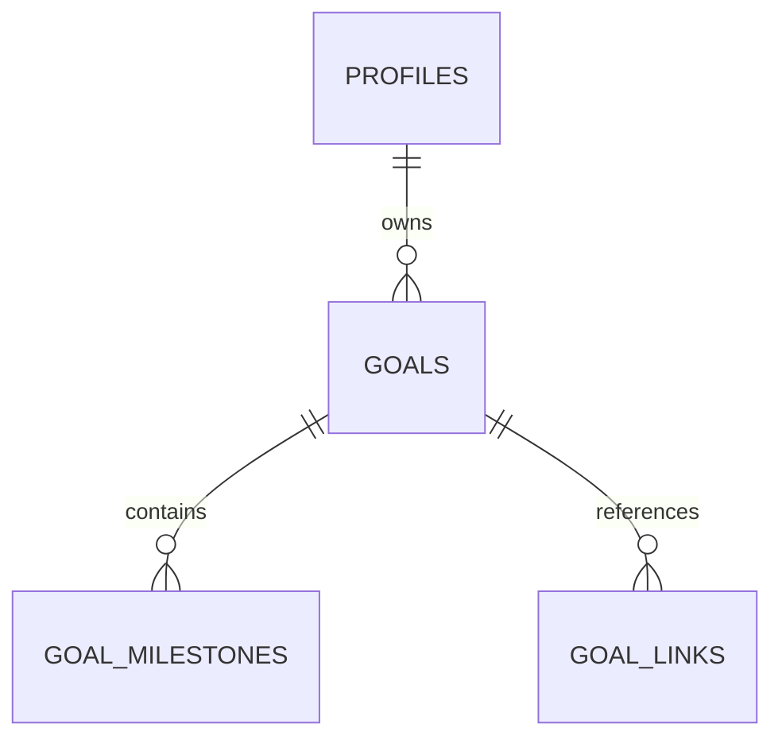
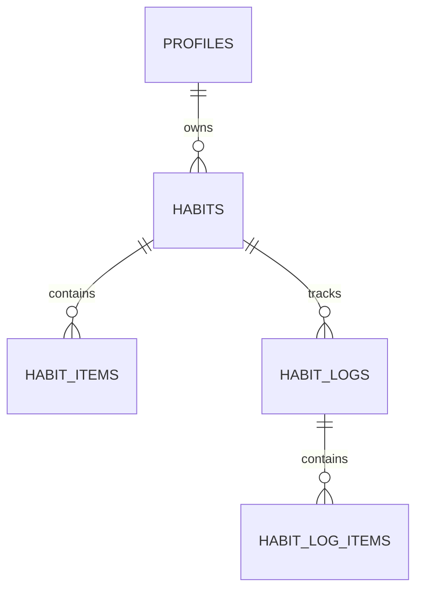
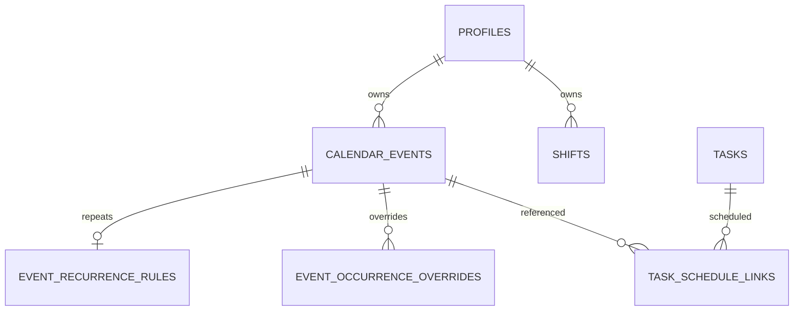
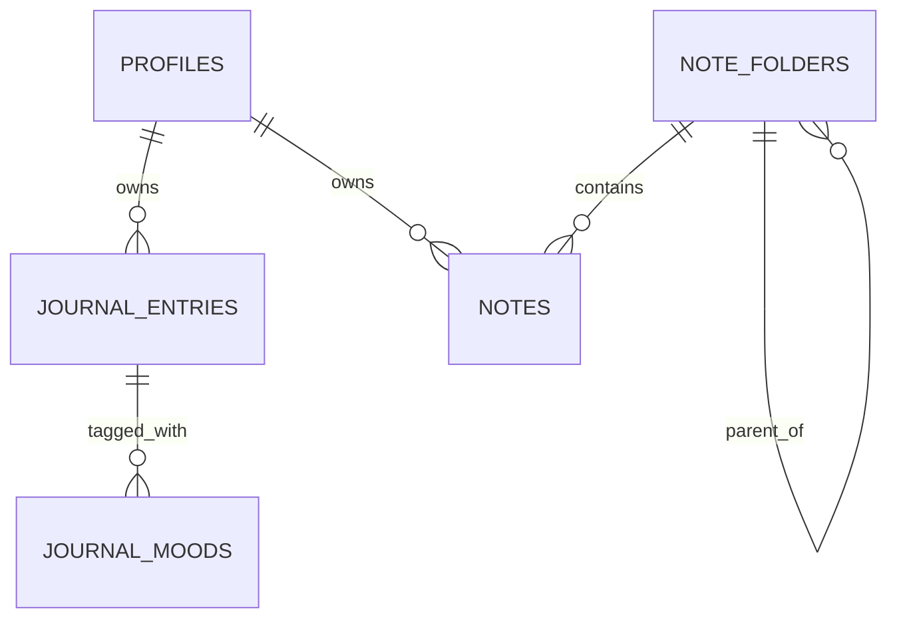
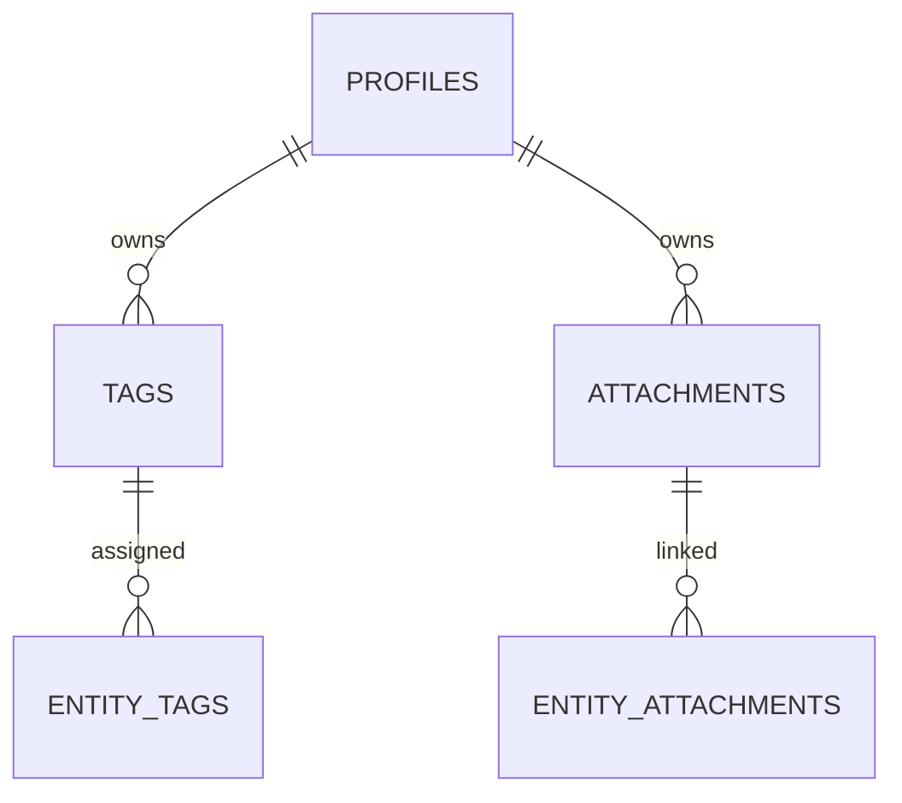
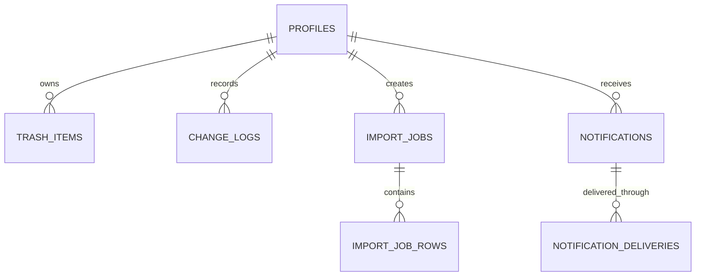

# LIFEOS DATABASE ERD & RELATIONSHIP SPECIFICATION

**Project:** LIFEOS  
**Version:** 1.0  
**Status:** Database Architecture Specification  
**Database:** MySQL 8.0+  
**Engine:** InnoDB  
**Reference:** LIFEOS_DATABASE_REVIEW.md

---

# 1. PURPOSE

Dokumen ini mendefinisikan relasi antar-entitas database LIFEOS.

ERD digunakan sebagai referensi untuk:

- SQL migration.
- Foreign key constraints.
- Repository implementation.
- Service business rules.
- Database testing.
- Data integrity validation.

Dokumen ini melengkapi:

- LIFEOS_DATABASE_DESIGN.md
- LIFEOS_DATABASE_REVIEW.md

---

# 2. RELATIONSHIP CONVENTIONS

Notasi:

| Symbol | Meaning |
|---|---|
| 1 | Exactly one |
| 0..1 | Zero or one |
| 0..N | Zero or many |
| 1..N | One or many |

Contoh:

`profiles 1 ---- 0..N tasks`

Artinya satu profile dapat memiliki banyak task, sedangkan satu task hanya dimiliki satu profile.

## Foreign Key Rules

- Setiap foreign key harus memiliki index.
- Relasi antar-profile harus divalidasi.
- Jangan mengandalkan UUID sebagai pengganti foreign key.
- Polymorphic relations harus divalidasi melalui service.
- Soft-deleted records tetap mempertahankan relasi historis.
- Hindari cascade delete untuk data utama yang harus dapat dipulihkan.

---

# 3. CORE RELATIONSHIPS

## 3.1 Profile

Profile menjadi root ownership untuk data personal.

Satu profile dapat memiliki banyak resource.

Resource personal tidak boleh berpindah profile tanpa operasi transfer ownership yang eksplisit.

---

# 4. FINANCE RELATIONSHIPS

## 4.1 Finance ERD

## 4.2 Finance Cardinality

| Relationship | Cardinality |
|---|---|
| Profile → Accounts | 1:N |
| Profile → Transactions | 1:N |
| Transaction → Transaction Lines | 1:N |
| Account → Transaction Lines | 1:N |
| Transaction → Transfer | 1:0..1 |
| Loan → Loan Payments | 1:N |
| Transaction → Loan Payment | 1:0..1 |
| Budget → Budget Items | 1:N |
| Recurring Template → Occurrences | 1:N |
| Occurrence → Generated Transaction | 1:0..1 |

## 4.3 Finance Integrity Rules

1. Transaction harus memiliki minimal satu transaction line.
2. Income harus memiliki pergerakan uang masuk.
3. Expense harus memiliki pergerakan uang keluar.
4. Transfer harus memiliki dua transaction lines.
5. Transfer source dan destination tidak boleh sama.
6. Transfer amount harus seimbang.
7. Loan payment harus terhubung ke satu transaksi kas.
8. Loan payment tidak boleh menghasilkan transaksi kas kedua.
9. Budget item hanya menggunakan kategori expense.
10. Recurring occurrence tidak boleh menghasilkan transaksi ganda.

## 4.4 Project Finance Relationship

`transactions.project_id` bersifat nullable.

Relasi:

`PROJECTS 1 ---- 0..N TRANSACTIONS`

Satu transaksi hanya boleh terhubung ke satu project pada v1.

Project actual budget dihitung dari transaksi expense yang relevan.

Transfer tidak dihitung sebagai actual expense.

Pembayaran pokok pinjaman tidak dihitung sebagai expense project secara otomatis.

---

# 5. PROJECT & TASK RELATIONSHIPS

## 5.1 Project ERD

## 5.2 Cardinality

| Relationship | Cardinality |
|---|---|
| Profile → Projects | 1:N |
| Project → Tasks | 1:N |
| Project → Milestones | 1:N |
| Task → Subtasks | 1:N |
| Task → Dependencies | 1:N |
| Task → Time Logs | 1:N |
| Task → Schedule Links | 1:N |

Task tanpa project diperbolehkan.

Task parent dan child harus berada dalam profile yang sama.

## 5.3 Task Dependency

`task_dependencies` memiliki dua foreign key menuju `tasks`.

- `task_id`
- `depends_on_task_id`

Aturan:

- Tidak boleh self-reference.
- Tidak boleh duplicate dependency.
- Tidak boleh circular dependency.
- Dependency hanya memberikan warning.
- Dependency tidak mengunci perubahan status task.

Cycle detection wajib dilakukan melalui service.

---

# 6. GOAL RELATIONSHIPS

`goal_links` menggunakan polymorphic relationship.

Entity type yang diizinkan:

- project
- task
- habit
- finance

Target ID tidak memiliki satu foreign key universal.

Service harus memastikan target benar-benar tersedia dan dimiliki profile yang sama.

Progress goal menggunakan salah satu mode:

- linked_items
- measurable_target

Jangan mencampur dua metode perhitungan dalam satu goal tanpa aturan kontribusi yang eksplisit.

---

# 7. HABIT RELATIONSHIPS

Cardinality:

| Relationship | Cardinality |
|---|---|
| Profile → Habits | 1:N |
| Habit → Habit Items | 1:N |
| Habit → Habit Logs | 1:N |
| Habit Log → Habit Log Items | 1:N |

Constraint:

`UNIQUE(habit_id, log_date)`

Satu habit memiliki maksimal satu ringkasan log per hari.

Checklist disimpan di `habit_log_items`.

Streak dihitung berdasarkan schedule habit dan rest days.

---

# 8. CALENDAR RELATIONSHIPS

## Calendar Decisions

- Calendar event adalah sumber data utama untuk event umum.
- Shift adalah sumber data utama untuk shift kerja.
- Task adalah sumber data utama untuk task.
- Task schedule link menghubungkan task dengan calendar event.
- Shift tidak diduplikasi sebagai calendar event.
- Recurrence rule dimiliki satu calendar event.
- Satu occurrence override hanya berlaku untuk satu occurrence.

Calendar UI dapat menggabungkan event, shift, dan task menjadi satu tampilan melalui calendar service.

Jangan menggabungkan seluruh jenis data ke satu tabel hanya demi kemudahan tampilan.

---

# 9. JOURNAL & NOTES RELATIONSHIPS

Journal:

- Satu profile dapat memiliki banyak journal entries.
- Satu tanggal dapat memiliki banyak journal entries.
- Satu entry dapat memiliki satu atau beberapa mood sesuai implementasi mood model.

Notes:

- Satu folder dapat memiliki banyak notes.
- Folder dapat memiliki parent folder.
- Note tanpa folder diperbolehkan.
- Folder tidak boleh memiliki circular parent relationship.

---

# 10. TAGS & ATTACHMENTS RELATIONSHIPS

`entity_tags` dan `entity_attachments` merupakan polymorphic relations.

Allowed entity types harus didefinisikan melalui whitelist.

Attachment tidak boleh dihapus secara fisik selama masih direferensikan oleh resource yang dapat di-restore.

---

# 11. SYSTEM RELATIONSHIPS

Trash item menunjuk resource yang dihapus.

Change log menyimpan informasi perubahan tanpa harus menduplikasi seluruh data resource.

Import job menyimpan metadata proses import dan staging rows.

Notification delivery menyimpan status masing-masing channel.

---

# 12. POLYMORPHIC RELATIONSHIP POLICY

Tabel berikut menggunakan polymorphic references:

- goal_links
- entity_tags
- entity_attachments
- trash_items

Karena MySQL tidak dapat menerapkan foreign key biasa terhadap banyak kemungkinan tabel target, seluruh operasi harus melalui service validation.

Setiap polymorphic record harus memiliki:

- entity_type.
- entity_id.
- profile context.

Entity type harus menggunakan allowlist.

Dilarang menerima nama tabel bebas dari input pengguna.

---

# 13. DELETE & RESTORE RELATIONSHIPS

## Soft Delete

Soft delete tidak menghapus foreign key parent-child.

Resource yang dihapus tetap tersedia untuk proses restore.

## Restore

Restore harus memeriksa:

- Parent resource.
- Unique constraint.
- Ownership.
- Attachment references.
- Related active records.

## Permanent Delete

Permanent delete dilakukan secara terkontrol.

Gunakan dependency-aware deletion service.

Jangan menerapkan ON DELETE CASCADE secara luas pada tabel transaksi, jurnal, task history, dan attachment.

---

# 14. CRITICAL RELATIONSHIP CONSTRAINTS

| Relationship | Required Rule |
|---|---|
| Transaction → Lines | Minimal satu line |
| Transfer → Lines | Tepat dua lines |
| Loan → Payments | Principal tidak boleh negatif |
| Recurring Template → Occurrence | Unique occurrence |
| Habit → Log | Maksimal satu summary per hari |
| Project → Task | Maksimal satu project per task |
| Task → Dependency | Tidak boleh cycle |
| Calendar Event → Recurrence | Maksimal satu rule aktif |
| Calendar Event → Override | Satu override per occurrence |
| Note Folder → Parent Folder | Tidak boleh cycle |
| Goal → Linked Entity | Ownership wajib cocok |
| Attachment → Entity | Reference harus valid |

Constraint yang tidak dapat direpresentasikan dengan foreign key atau CHECK constraint harus dijaga melalui service dan automated tests.

---

# 15. IMPLEMENTATION NOTES

Sebelum SQL migration:

1. Finalisasi seluruh nama tabel.
2. Finalisasi seluruh kolom foreign key.
3. Tentukan ON DELETE behavior per relasi.
4. Tentukan unique constraints.
5. Tentukan index.
6. Tentukan nullable fields.
7. Tentukan soft delete behavior.
8. Pastikan urutan migration mengikuti dependency.
9. Uji migration dari database kosong.
10. Uji rollback migration.

ERD ini adalah logical relationship specification.

Tipe data, panjang kolom, index detail, dan SQL constraint final tetap ditetapkan pada database migration specification.

---

# 16. ACCEPTANCE CRITERIA

ERD dianggap siap jika:

- Semua entity utama memiliki ownership yang jelas.
- Semua relasi 1:N dan 1:1 sudah ditentukan.
- Relasi polymorphic memiliki aturan validasi.
- Tidak ada sumber data ganda untuk shift, task, atau transaksi.
- Relasi keuangan menjaga integritas ledger.
- Recurrence memiliki identitas occurrence.
- Soft delete dan restore tidak merusak relasi.
- Tidak ada circular dependency yang dibiarkan.
- Seluruh relasi dapat diuji secara otomatis.

---

# END OF DATABASE ERD SPECIFICATION